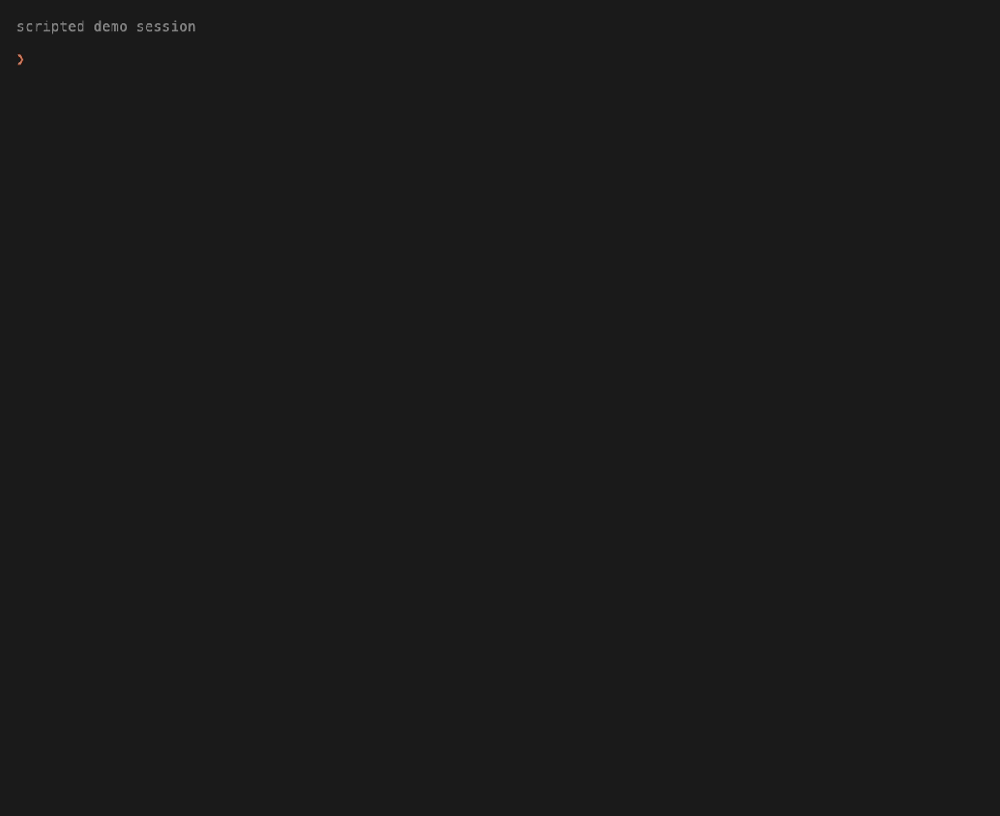

# grill-me-tui

A minimal terminal UI for Claude Code that lets you answer the questions of Matt Pocock's `grill-me` interview one at a time, in a split pane below your session.



## Install

You need [Claude Code](https://claude.com/claude-code), [Bun](https://bun.sh) and Matt Pocock's `grilling` skill:

```sh
npx skills add mattpocock/skills --skill grilling -g -a claude-code -y
```

Then pick **one** of the two options (not both, or the hook runs twice).

**Option 1: install script** (command: `/grill`)

```sh
git clone https://github.com/gslama12/grill-me-tui ~/.local/share/grill-me-tui   # or any permanent place
~/.local/share/grill-me-tui/install.sh
```

It links the skill and hook into `~/.claude`, merges the hook into `settings.json` (with a backup) and puts a `grill` command in `~/.local/bin`. Update with `git pull`; uninstall with `~/.local/share/grill-me-tui/uninstall.sh`.

**Option 2: Claude Code plugin** (command: `/grill:grill`)

```
/plugin marketplace add gslama12/grill-me-tui
/plugin install grill@grill-me-tui
```

- Add `"CLAUDE_CODE_STOP_HOOK_BLOCK_CAP": "200"` under `"env"` in `~/.claude/settings.json`, so long interviews aren't cut off.
- Optional, for a `grill` command in your own terminal: `mkdir -p ~/.local/bin && ln -s ~/.claude/plugins/marketplaces/grill-me-tui/grill/tui.ts ~/.local/bin/grill`

Uninstall with `/plugin uninstall grill@grill-me-tui`.

## How to Use

Start a new Claude Code session and type `/grill <topic>` (or `/grill:grill <topic>` with the plugin), at the start of a message or anywhere in it. `/grill-me` stays the chat version.


## Environments

| Terminal | Status |
| --- | --- |
| herdr | Tested (macOS) |
| tmux | Tested (macOS) |
| WezTerm | Tested (macOS) |
| Zellij | Untested |
| kitty (needs `allow_remote_control`) | Untested |
| iTerm2 (macOS) | Untested |
| Ghostty and others | Not supported |

## How it works

- `/grill` is a skill that runs `grilling`, but has Claude end each round with a JSON block of questions.
- A Stop hook, added by `install.sh` or the plugin, reads that block when Claude finishes its message.
- The hook opens the TUI (a Bun script) in a split below Claude's pane, or uses a `grill` you already started in another terminal.
- Hook and TUI talk over a Unix socket in `/tmp/claude-grill`: questions go in, your answers come back.
- The hook returns the answers to Claude, which writes the next round; when there are no more questions, the TUI closes and Claude sums up in chat.
